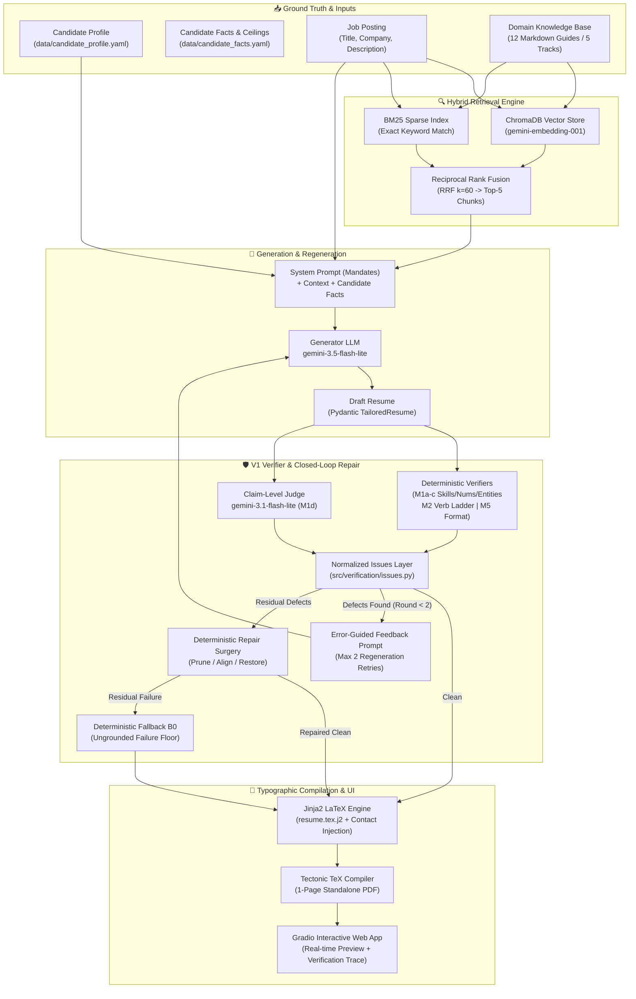

# 📄 Resume RAG Generator — Grounded Tailored Resumes for Tech Internships

[](https://www.python.org/downloads/)
[](https://www.llamaindex.ai/)
[](https://ai.google.dev/)
[](https://www.trychroma.com/)
[](https://tectonic-typesetting.github.io/)
[](https://gradio.app/)
[](tests/)
[-success.svg)](docs/experiments/E02_verifier.md)
[-success.svg)](docs/experiments/E02_verifier.md)
[](LICENSE)

> A production-grade, empirically validated **Retrieval-Augmented Generation (RAG)** system that synthesizes tailored, ATS-compliant, single-page technology internship resumes. Powered by **LlamaIndex**, **Google Gemini**, **ChromaDB**, and **Tectonic LaTeX**, the system pairs hybrid knowledge retrieval with an automated **post-generation verifier loop**, multi-turn error-guided regeneration, and deterministic repair to reduce factual fabrication to **0.4%** and eliminate verb inflation.

---

## 🎯 The Problem & The Solution

- **The Challenge:** Applying to competitive international technology internships across specialized subfields (AI/RAG, Data Science, Backend, Core SWE, Data Engineering) with a generic resume hurts interview callback rates. However, naive LLM tailoring causes widespread hallucinations: fabricating tools and metrics, upgrading responsibilities (*"managed"* $\rightarrow$ *"architected"*), and leaking candidate PII.
- **The Solution:** A closed-loop, verified RAG architecture that:
  1. Ingests verified candidate ground truth (`data/candidate_profile.yaml`) and atomic propositions with 4-level scope ceilings (`data/candidate_facts.yaml`).
  2. Retrieves target track intelligence from a 12-document recruitment knowledge base using **Hybrid Search** (Dense ChromaDB + BM25 merged via Reciprocal Rank Fusion).
  3. Strips candidate contact data before LLM transmission to preserve strict privacy (SEC-01).
  4. Audits generated claims with deterministic verifiers (M1a–c, M2, M4, M5) and an isolated claim-level judge (M1d).
  5. Corrects defects through multi-turn error-guided feedback (`clean@1`, `clean@2`), deterministic surgical repair (`repaired`), or a grounded fallback floor (`fallback`).
  6. Renders a publication-grade, 1-page PDF using Jinja2 and Tectonic.

---

## 🏗️ System Architecture



---

## ✨ Key Features & Engineering Highlights

| Feature | Description |
|---|---|
| **V1 Closed-Loop Verifier** | Post-generation verification loop combining deterministic checkers (allowlists, numbers, dates, titles, verb ladder) with a separate LLM claim judge. |
| **Multi-Turn Regeneration** | When defects are detected, the system feeds actionable defect line items back to the LLM (`clean@1`, `clean@2`) before falling back to deterministic surgery. |
| **Deterministic Repair Surgery** | Automatically strips unverified skills, clamps inflated verbs, aligns corrupted dates/titles with profile ground truth, and restores verified bullets if an entry empties. |
| **Separate Generator & Judge** | Enforces architectural independence: generator runs `gemini-3.5-flash-lite`, while the claim evaluator uses `gemini-3.1-flash-lite` (temperature 0.0), eliminating self-evaluation bias. |
| **Privacy Safeguard (SEC-01)** | Contact PII (email, phone, home address, social URLs) is stripped before prompt serialization and injected at LaTeX render time. |
| **Hybrid RAG (Dense + BM25)** | Combines semantic embeddings with BM25 keyword matching fused via Reciprocal Rank Fusion (RRF, k=60), beating full-context stuffing by +7.2% coverage. |
| **Multilingual (EN / FR / PT)** | Full localization support for international applications across French, English, and Portuguese job descriptions. |
| **Standalone LaTeX Engine** | Fast, deterministic 1-page PDF compilation via **Tectonic** (zero TeX Live bloat, sub-second compilation). |

---

## 📊 Empirical Evaluation & Ablation Results

The system was evaluated against real tech internship postings across AI, Data, Backend, and Core SWE tracks governed by the frozen research protocol (`docs/research_plan.md`):

### 1. Headline Results Across Variants

| Metric | B0 (Fallback Floor) | B1 (One-Step RAG) | B3 (Full KB Prompt) | V1 (RAG + Verifier) | B3 + Verifier |
|---|:---:|:---:|:---:|:---:|:---:|
| **Hard-Pass Rate** | 0.0%* | 0.0% | 0.0% | **28.6%** | **42.9%** |
| **M1 Fabrication Rate** | **0.0%** | 11.71 claims/res | 7.43 claims/res | **0.4%** | **0.2%** |
| **M2 Verb Inflation** | **0.0%** | 16.7% | 28.6% | **0.0%** | **0.0%** |
| **M3 Requirement Coverage** | 43.1% | 14.2% | 15.6% | **44.7%** | 37.5% |
| **M4 Truthful Keywords** | 100.0% | 100.0% | 100.0% | **100.0%** | 97.6% |
| **Prompt Footprint** | 0 tokens | ~1,200 words | ~5,400 words | **~1,200 words** | ~5,400 words |

*\*B0 provides a grounded factual floor; its hard-pass failure stems purely from multilingual template label alignment on international postings.*

### 2. Validated Hypotheses

- **Hypothesis H1 (Adopted — E02):** The post-generation verifier with error-guided regeneration drops fabrication and inflation from >10 claims/resume to **0.4%** ($M1+M2 \le 5\%$), while boosting coverage by **+30.5 percentage points** over B1.
- **Hypothesis H4 (Adopted — E03):** Hybrid RAG retrieval outperforms full-context stuffing by **+7.2 percentage points** in requirement coverage ($\ge +5.0\text{ p.p.}$ threshold satisfied) with over **4x higher prompt token efficiency**.

Detailed benchmark logs and manifests are available in:
- [`docs/experiments/E00_judge.md`](docs/experiments/E00_judge.md): Judge Validation (0.92% claim FPR, 90% synthetic defect recall).
- [`docs/experiments/E01_baselines.md`](docs/experiments/E01_baselines.md): Baseline Benchmarks (B0, B1, B3).
- [`docs/experiments/E02_verifier.md`](docs/experiments/E02_verifier.md): Verifier V1 Benchmark.
- [`docs/experiments/E03_rag_ablation.md`](docs/experiments/E03_rag_ablation.md): RAG Ablation Benchmark.

---

## 📂 Project Structure

```text
gerador_curriculos/
├── app.py                         # Root entrypoint (Gradio / Hugging Face Spaces)
├── pyproject.toml                 # Package specifications & dependencies
├── requirements.txt               # Frozen reproducible production dependencies
├── Dockerfile                     # Multi-stage production container with Tectonic
├── docker-compose.yml             # Local single-command orchestration
├── .dockerignore                  # Build optimization filter
├── .env.example                   # Environment configuration template
│
├── data/
│   ├── candidate_profile.yaml     # Candidate source of truth (education, projects, skills)
│   ├── candidate_facts.yaml       # Atomic verified facts with 4-level scope ceilings
│   └── eval/
│       ├── MANIFEST.sha256        # Dataset integrity hash
│       └── dev/                   # Benchmark test cases (AI, Data, SWE, Backend)
│
├── src/
│   ├── config.py                  # Pydantic Settings, model pinning & API validation
│   ├── app.py                     # Gradio Web UI implementation & handlers
│   │
│   ├── data/                      # Pydantic v2 schemas
│   │   ├── candidate.py           # CandidateProfile schema & YAML parser
│   │   ├── facts.py               # AtomicFact schema & 4-level verb scope ladder
│   │   ├── job_posting.py         # JobPosting & semantic search query generator
│   │   └── resume.py              # TailoredResume & recursive LaTeX escaping
│   │
│   ├── ingestion/                 # Document ingestion & vectorization
│   │   ├── loader.py              # Markdown document loader & metadata enrichment
│   │   └── indexer.py             # SentenceSplitter & ChromaDB vector index builder
│   │
│   ├── retrieval/                 # Search & ranking algorithms
│   │   ├── retriever.py           # HybridResumeRetriever (ChromaDB + BM25 + RRF)
│   │   └── pipeline.py            # End-to-end KnowledgeBasePipeline lifecycle manager
│   │
│   ├── generation/                # Prompting & compilation
│   │   ├── prompts.py             # System prompts, SEC-01 serializer, feedback prompt
│   │   ├── chain.py               # ResumeGenerationChain & multi-turn regeneration
│   │   ├── formatter.py           # Jinja2 LaTeX renderer & Tectonic PDF compiler
│   │   └── variants/              # Generation variants (B0, B1, B3, V1)
│   │       ├── b0_fallback.py     # Deterministic fallback floor
│   │       ├── b1_baseline.py     # One-step RAG baseline
│   │       ├── b3_full_context.py # Full knowledge base context & B3+verifier
│   │       └── v1_verified.py     # Closed-loop verifier state machine
│   │
│   ├── verification/              # Deterministic verification & surgical repair
│   │   ├── fabrication.py         # M1a-c deterministic fabrication checks
│   │   ├── inflation.py           # M2 verb ladder & scope ceiling checks
│   │   ├── coverage.py            # M3 factual coverage calculation
│   │   ├── keywords.py            # M4 truthful ATS keyword alignment
│   │   ├── format_checks.py       # M5 format & single-page checks
│   │   ├── issues.py              # Normalized verification issue aggregator
│   │   ├── repair.py              # Deterministic resume repair surgery
│   │   └── report.py              # verify_resume orchestrator
│   │
│   ├── evaluation/                # Empirical evaluation & judge
│   │   ├── claim_judge.py         # Isolated claim-level judge (gemini-3.1-flash-lite)
│   │   ├── injection.py           # Synthetic defect injection harness (L1-L6)
│   │   └── benchmark.py           # Benchmark execution utilities
│   │
│   └── knowledge_base/            # Specialized domain knowledge (12 markdown files)
│       ├── resume_best_practices/ # Structure, STAR/XYZ bullets, ATS guidelines
│       └── hr_recruitment/        # Track priorities, recruiter advice, tech weighting
│
├── templates/
│   └── resume.tex.j2              # Multilingual Jinja2 LaTeX resume template (1-page)
│
├── tests/                         # Automated test suite (396 tests passing offline)
│   ├── golden/                    # Golden set regression checks (Amazon SDE fixture)
│   ├── test_schemas.py            # Pydantic model validation
│   ├── test_facts.py              # Atomic facts schema & scope ladder tests
│   ├── test_v1_variant.py         # V1 verifier state machine tests
│   ├── test_repair.py             # Deterministic repair surgery tests
│   ├── test_verification_core.py  # M1-M5 verifier unit tests
│   ├── test_claim_judge.py        # Claim-level judge offline tests
│   ├── test_retrieval.py          # Dense search, BM25, and RRF rank fusion
│   └── test_app.py                # Gradio UI actions & handlers
│
├── docs/                          # Technical documentation & ADRs
│   ├── architecture.md            # System architecture & stack overview
│   ├── research_plan.md           # Research plan, hypotheses, and decision protocol
│   ├── decisions_log.md           # 23 Architecture Decision Records (ADR-001 to ADR-023)
│   ├── development_diary.md       # Chronological development diary across all phases
│   ├── lessons.md                 # Qualitative engineering learnings
│   └── experiments/               # Empirical experiment reports (E00, E01, E02, E03)
│
└── output/                        # Directory for generated LaTeX sources and PDFs
```

---

## 🚀 Quickstart & Setup

### 1. Prerequisites
- Python 3.11 or 3.12
- Google Gemini API Key ([Google AI Studio](https://aistudio.google.com/))
- [Tectonic TeX Engine](https://tectonic-typesetting.github.io/en-US/install.html) (or run via Docker)

### 2. Local Installation

```bash
# Clone the repository
git clone https://github.com/seu-usuario/gerador-curriculos.git
cd gerador-curriculos

# Create and activate virtual environment
python3 -m venv .venv
source .venv/bin/activate

# Install dependencies
pip install -r requirements.txt
```

### 3. Configure Credentials

Create a `.env` file from the template:

```bash
cp .env.example .env
```

Set pinned model configurations in `.env`:
```env
GOOGLE_API_KEY=your_gemini_api_key_here
GENERATION_MODEL=gemini-3.5-flash-lite
JUDGE_MODEL=gemini-3.1-flash-lite
GENERATION_TEMPERATURE=0.3
JUDGE_TEMPERATURE=0.0
```

### 4. Running the Web Application

Launch the Gradio interface:

```bash
python app.py
```
Open your browser at `http://localhost:7860`.

---

## 🐳 Docker Deployment

Run the complete application inside a container with zero local LaTeX setup required:

```bash
# Start container with volume mounts for outputs and vector database
docker compose up --build
```
Access the application at `http://localhost:7860`.

---

## 🧪 Testing & Verification

The project includes **396 automated unit and integration tests** that run **100% offline** without calling external APIs:

```bash
# Run the complete offline test suite
pytest -q -p no:cacheprovider

# Run golden set regression checks
pytest tests/golden/ -v

# Run verification and repair tests
pytest tests/test_v1_variant.py tests/test_repair.py -v
```

---

## 🏛️ Architectural Decisions Log (ADRs)

Key architectural choices are formally documented in [`docs/decisions_log.md`](docs/decisions_log.md):

- **ADR-001 to ADR-011:** Foundations, LlamaIndex, ChromaDB, Tectonic, Gradio, RRF, Pydantic v2, Edge Cases.
- **ADR-012:** Containerization & Packaging.
- **ADR-013:** Native Multilingual Support (EN / FR / PT) & 1-Page Layout Guarantee.
- **ADR-014:** Pinned Models and Separate Evaluation Judge (`gemini-3.5-flash-lite` vs `gemini-3.1-flash-lite`).
- **ADR-015:** SEC-01 Contact Privacy Enforcement & Render-Time Injection.
- **ADR-016:** Golden Set Regression Harness (`tests/golden/`).
- **ADR-017:** Atomic Facts Schema & 4-Level Scope Ladder.
- **ADR-018:** Deterministic Verification Layer (`src/verification/`).
- **ADR-019:** Claim-Level Judge Architecture & Validation.
- **ADR-020:** Baseline Protocol E01 (B0, B1, B3).
- **ADR-021:** Closed-Loop Verifier V1 (Regeneration + Deterministic Surgery).
- **ADR-022:** RAG Ablation Outcome (V1 vs B3+Verifier) and H4 Adoption.
- **ADR-023:** Production UI Verifier Integration and Documentation Alignment.

---

## 📄 License

This project is licensed under the [MIT License](LICENSE).
