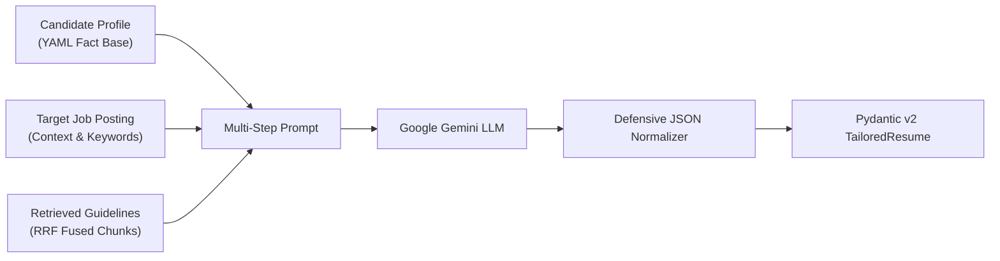

# 🧠 RAG Architecture & Pipeline Deep Dive

## 1. Overview and Problem Formulation

The **Resume RAG Generator** applies Retrieval-Augmented Generation (RAG) to solve the **resume tailoring paradox**:
- A generic resume underperforms across specialized technology tracks (AI/RAG, Data Science, Backend, Core SWE, Data Engineering).
- However, asking an ungrounded LLM to tailor a resume inevitably produces **hallucinations** (invented degrees, false employment contracts, inflated metrics).

Our RAG system decouples **domain recruitment guidelines** (stored in a vector knowledge base) from **candidate credentials** (stored in a verified YAML file), ensuring:
1. **Strategic Adaptation:** The resume emphasizes the exact competencies, action verbs, and formatting rules demanded by the job track.
2. **Absolute Grounding (0% Hallucination):** The LLM is structurally constrained to draw candidate facts exclusively from `candidate_profile.yaml`.

---

## 2. Ingestion & Vector Storage

```
src/knowledge_base/ (12 Markdown Documents across 2 Categories)
  ├── hr_recruitment/
  └── resume_best_practices/
       ↓
KnowledgeBaseLoader (enrich metadata: category, topic, file_name)
       ↓
SentenceSplitter (chunk_size=512 tokens, chunk_overlap=50 tokens)
       ↓
Google Gemini Embeddings (models/gemini-embedding-001, 3072 dimensions)
       ↓
ChromaDB Vector Store (Persistent Local Collection: 'resume_knowledge_base')
```

### Chunking Strategy
- **Chunk Size (512 tokens):** Sized to capture a complete cohesive guideline or recruitment track description without fragmentation.
- **Chunk Overlap (50 tokens):** Preserves semantic continuity across chunk boundaries.
- **Metadata Tagging:** Every chunk node is enriched with `category`, `topic`, and `file_name` to enable deterministic metadata filtering when required.

---

## 3. Hybrid Search & Reciprocal Rank Fusion (RRF)

### The Retrieval Challenge
Tech internship job postings contain a mix of:
- **Broad semantic intent:** e.g., *"machine learning algorithms"*, *"mission-critical systems"*.
- **Exact lexical keywords:** e.g., `"FastAPI"`, `"PostgreSQL"`, `"PyTorch"`, `"LlamaIndex"`, `"Docker"`.

Pure vector search excels at semantic matching but can overlook exact keyword occurrences. Pure BM25 keyword search catches exact acronyms but lacks semantic depth.

### The Hybrid Pipeline
```
Target Job Posting → job.to_search_query()
       │
       ├── Dense Vector Search (ChromaDB Cosine Similarity, top_k=8)
       │       → Ranked List 1: [Node A (rank 1), Node B (rank 2), ...]
       │
       └── Sparse Keyword Search (BM25 Token Index, top_k=8)
               → Ranked List 2: [Node C (rank 1), Node A (rank 2), ...]
       │
       ↓
Reciprocal Rank Fusion (RRF, constant k=60)
       ↓
Final Fused & Deduplicated Candidates (top_k=5)
```

### Reciprocal Rank Fusion Mathematics
RRF computes a composite score for each candidate document $d$:

$$RRF\\_Score(d) = \sum_{m \in M} \frac{1}{k + r_m(d)}$$

Where:
- $M$: Set of retrievers (Dense Vector, BM25).
- $r_m(d)$: 1-indexed rank of document $d$ in retriever $m$.
- $k$: Smoothing constant set to **60** (industry standard).

**Why RRF instead of Weighted Score Sum?**
Cosine similarity produces scores in $[-1, 1]$ or $[0, 1]$, while BM25 produces unbounded scores in $[0, \infty)$. Combining them with arbitrary weights requires empirical score normalization that breaks across queries. RRF is **parameter-free and score-scale invariant**, relying solely on rank order.

---

## 4. Structured Synthesis & Anti-Hallucination Guardrails

The LLM is governed by **five strict system mandates**:

1. **Absolute Factual Grounding:** Draw education, experiences, projects, and skills exclusively from the candidate profile. NEVER manufacture unlisted credentials.
2. **Tailoring via Structural Emphasis:** Selectively foreground real projects and skills that have highest relevance to the target job description.
3. **High-Impact Typographical Phrasing:** Apply Google's XYZ formula (*"Accomplished [X], as measured by [Y], by doing [Z]"*) using strong active verbs.
4. **Contextual ATS & Keyword Alignment:** Naturally integrate explicit technologies from the job posting into existing bullet points.
5. **Strict JSON Schema Compliance:** Respond exclusively with a single JSON payload matching the `TailoredResume` Pydantic v2 schema.



---

## 5. Typographical Pipeline: LaTeX & Tectonic

```
TailoredResume Pydantic Model
       ↓
Recursive LaTeX Escaping (replaces &, %, $, #, _, {, }, ~, ^, \)
       ↓
Jinja2 Template Engine (templates/resume.tex.j2)
       ↓
Rendered LaTeX Document (.tex)
       ↓
Tectonic Compiler (Standalone TeX Engine)
       ↓
Publication-Quality 1-Page PDF (output/resume_*.pdf)
```

### Why Tectonic over pdflatex / TeX Live?
- **Zero Configuration:** Tectonic is a modern, standalone executable (Rust-based) that bundles the TeX engine, XeTeX parser, and fontconfig into a single self-contained binary.
- **Lightweight Containers:** Docker images with TeX Live often exceed 4 GB. With Tectonic, the total container image is under 400 MB.
- **Reliable Automation:** Tectonic automatically manages multiple compilation passes without requiring external tools like `latexmk`.

---

## 6. Evaluation Framework & Tri-Axial Scoring

We evaluate RAG quality across three orthogonal dimensions:

| Dimension | Measured Aspect | Evaluator Backend |
|---|---|---|
| **Faithfulness** | Are all resume claims grounded in the candidate profile? (1.0 = zero hallucination) | LlamaIndex `FaithfulnessEvaluator` |
| **Answer Relevancy** | Is the resume tailored to the target job description? | LlamaIndex `RelevancyEvaluator` |
| **Context Precision** | Did the retriever return signal rather than noise? | LlamaIndex `ContextRelevancyEvaluator` |

### Aggregate Score (Geometric Mean)
To prevent a system with strong relevance but weak faithfulness from scoring high, we aggregate metrics using the geometric mean:

$$\text{Aggregate} = \left(\text{Faithfulness} \times \text{Answer Relevancy} \times \text{Context Precision}\right)^{1/3}$$

If any metric drops to 0 (e.g., severe hallucination), the aggregate score immediately drops to 0.
